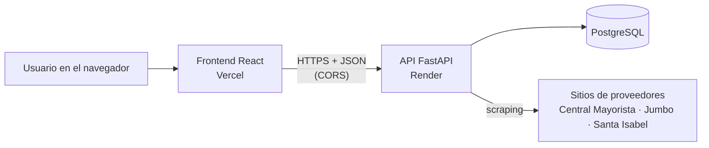
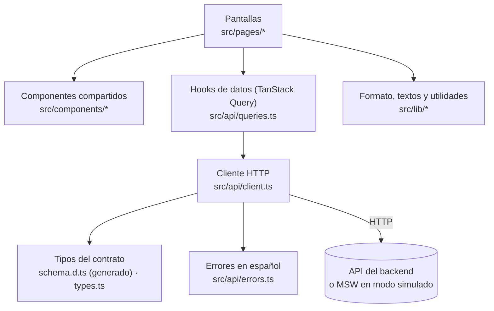
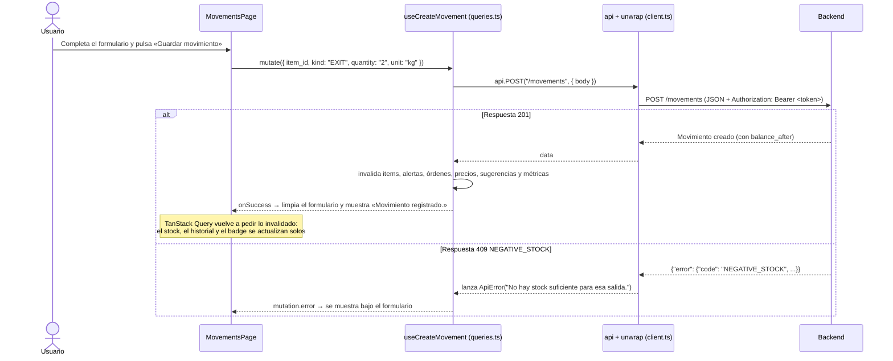
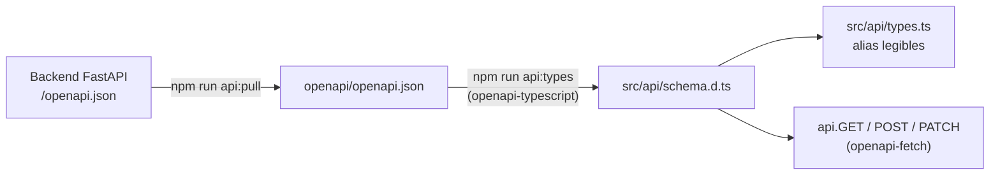
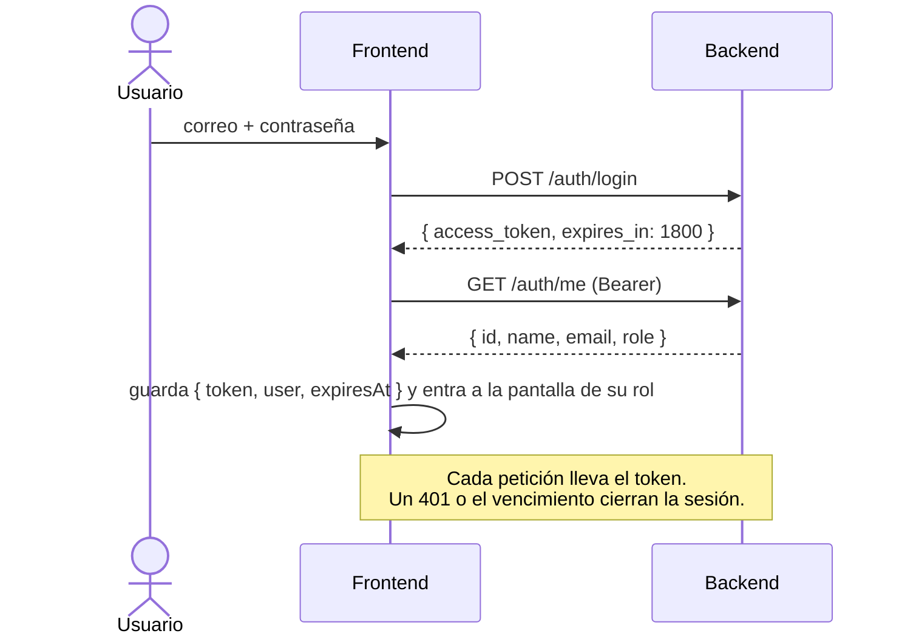
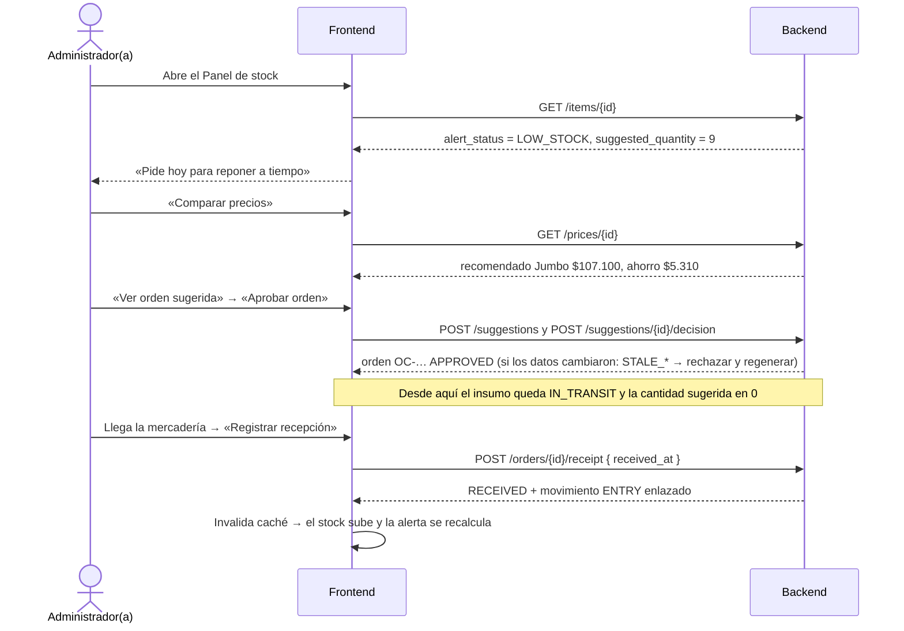

# Frontend de StockSmart: funcionamiento e integración con el backend

Estado al 20-10-2026. Frontend en este repositorio; backend en `Proyecto-GPTI-grupo-4-back`, rama
`codex/deploy-render` (commit `42b02fb`, API v0.2.0).

> **Ojo:** al 20-10, `main` del backend todavía **no** tiene login, sugerencias ni métricas: están en las ramas
> `fix/backend-e2-audit-completion` y `codex/deploy-render`, sin fusionar. El frontend está integrado contra
> `codex/deploy-render`, que incluye todo lo anterior.

Este documento explica cómo está construido el frontend, cómo viaja cada dato entre la pantalla y la API, y
qué partes ya están conectadas con el backend real. Para instalar y correr el proyecto, ver el
[README](../README.md).

---

## 1. Resumen

- **Qué es:** una aplicación web (SPA) en español para la pyme gastronómica. Registra el inventario, avisa
  cuándo reponer, compara precios de proveedores y gestiona órdenes de compra.
- **Stack:** React 19 + TypeScript, Vite, React Router, TanStack Query (datos del servidor), `openapi-fetch`
  (cliente HTTP tipado) y MSW (backend simulado). Se publica en Vercel.
- **Relación con el backend:** el frontend **no calcula reglas de negocio**. Alertas, consumo, proyección,
  cantidad sugerida, comparación de precios y saldos los calcula el backend; el frontend los pide, los muestra y
  envía las acciones del usuario.
- **Contrato:** el `openapi.json` que publica el backend (FastAPI). De ahí se generan los tipos de TypeScript,
  así que si el backend cambia una respuesta, el frontend deja de compilar en el lugar exacto que hay que ajustar.
- **Seguridad:** todas las rutas del backend, salvo el login, exigen un token JWT, y el backend aplica los roles.
  El frontend obtiene el token al iniciar sesión y lo envía en cada petición.

---

## 2. Formas de ejecutarlo

| Comando | Backend que usa | Para qué |
|---|---|---|
| `npm run dev` | El real, en `VITE_API_URL` (por defecto `http://127.0.0.1:8000`) | Integración y uso normal |
| `npm run dev:mock` | Simulado en el navegador (MSW), con datos de ejemplo | Demo y desarrollo sin backend |
| `npm test` | Simulado en Node (MSW) | Pruebas automáticas del cliente de la API |
| `npm run build` | — | Revisa tipos y genera `dist/` para Vercel |

El modo lo deciden dos variables de entorno, que Vite incluye **al compilar** (cambiarlas exige volver a
compilar o desplegar):

| Variable | Archivo | Efecto |
|---|---|---|
| `VITE_API_URL` | `.env.local` o Vercel | URL base de la API |
| `VITE_USE_MOCKS=true` | `.env.mock` (lo usa `--mode mock`) | Arranca MSW antes de mostrar la app. Solo tiene efecto con `--mode mock` (`USE_MOCKS` en `src/lib/config.ts`) |
| `VITE_BUSINESS_NAME` | opcional | Nombre del negocio bajo la marca |

Del lado del backend hacen falta:

| Variable del backend | Para qué |
|---|---|
| `STOCKSMART_DATABASE_URL` | Base PostgreSQL |
| `STOCKSMART_JWT_SECRET` | Clave para firmar los tokens (al menos 32 bytes aleatorios) |
| `STOCKSMART_JWT_TTL_MINUTES` | Duración del token (por defecto, 30 minutos) |
| `STOCKSMART_CORS_ORIGINS` | Orígenes del frontend (hoy: `http://localhost:5173` y `https://stocksmart-nine.vercel.app`) |

Los usuarios se crean en el backend con `python -m app.manage_users <correo> --name "<nombre>" --role ADMIN`
(o `WAREHOUSE`); el comando pide la contraseña (entre 12 y 72 caracteres).

---

## 3. Arquitectura en capas

Cada capa solo conoce a la de abajo. Las pantallas nunca llaman a `fetch` directamente.

| Carpeta / archivo | Responsabilidad |
|---|---|
| `openapi/openapi.json` | Copia del contrato del backend, versionada para poder compilar sin backend |
| `src/api/schema.d.ts` | Tipos **generados** desde el contrato (no se edita a mano) |
| `src/api/types.ts` | Nombres legibles para esos tipos (`ItemState`, `Movement`, `Suggestion`…) y los que OpenAPI no describe |
| `src/api/client.ts` | Cliente HTTP: URL base, token, aviso de sesión vencida (401) y `unwrap()` |
| `src/api/errors.ts` | `ApiError` y traducción de cada `code` del backend a un mensaje en español |
| `src/api/queries.ts` | Un hook por consulta o acción (`useItem`, `useCreateMovement`…) y la invalidación de caché |
| `src/auth/` | Sesión, token, roles y rutas protegidas |
| `src/state/` | Insumo seleccionado, compartido entre pantallas |
| `src/lib/` | Formato de cantidades, fechas y pesos; textos de los estados; historial; scraping |
| `src/components/` | Barra lateral, selector de insumo, gráficos, avisos y badges |
| `src/pages/` | Una pantalla por ruta |
| `src/mocks/` | Backend simulado: `db.ts` (datos y reglas aproximadas) y `handlers.ts` (rutas) |

---

## 4. El recorrido de una petición

Ejemplo: el Encargado(a) de bodega registra una **salida de 2 kg** en *Movimientos*.

Puntos clave:

1. **La pantalla no arma URLs ni lee JSON.** Llama a un hook de `queries.ts` con datos ya tipados.
2. **El tipo del cuerpo viene del contrato.** Si el backend renombrara `quantity`, `api.POST('/movements', …)`
   dejaría de compilar.
3. **Después de escribir, se invalida la caché** y React Query vuelve a pedir los datos afectados. No hay que
   actualizar a mano cada pantalla.
4. **Los errores siempre llegan como `ApiError`** con un mensaje en español listo para mostrar.

---

## 5. Contrato y tipos

### 5.1 Del backend a TypeScript

- `npm run api:pull` descarga el contrato desde el backend en ejecución (usa `VITE_API_URL`) y regenera los tipos.
- `npm run api:types` solo regenera los tipos desde `openapi/openapi.json`.
- Después, `npm run build` muestra cada lugar del código que el cambio afecta.

> `openapi-typescript` aún exige TypeScript 5 y el proyecto usa TypeScript 6; por eso el script lo ejecuta con
> `npx` y su propio TypeScript 5, sin instalarlo en el proyecto.

### 5.2 Tipos que OpenAPI no describe

Cuatro estructuras llegan sin forma en OpenAPI; el frontend las tipa a mano en `types.ts` leyendo el código
del backend. **Si el backend las cambia, TypeScript no lo detecta**: hay que revisar `types.ts` a mano.

| Dato | Tipo en el front | Fuente en el backend |
|---|---|---|
| `PricesResponse.comparison` | `PriceComparison`, `PriceOption` | `compare_offers` (`scraper/pipeline.py`) |
| `ScrapeRun.message` (texto con JSON) | `ScrapeRunProductResult` | `services/prices.py` |
| `Suggestion.inputs_snapshot` | `SuggestionSnapshot` | `services/suggestions.py` |
| Respuesta de `GET /metrics` | `Metrics` | `services/metrics.py` |

---

## 6. Cliente HTTP y manejo de errores (`client.ts`, `errors.ts`)

| Pieza | Qué hace |
|---|---|
| `API_URL` | `VITE_API_URL` sin `/` final |
| `api` | Cliente `openapi-fetch` tipado con `paths` del contrato |
| Middleware `auth` | Agrega `Authorization: Bearer <token>` y, si una respuesta (que no sea el login) es 401, avisa a la sesión para cerrarla |
| `unwrap(promesa)` | Devuelve `data` o lanza `ApiError` con el sobre de error del backend |

**Sobre de error.** El backend responde siempre
`{"error": {"code": "NEGATIVE_STOCK", "message": "…", "details": [...]}}`: 401 sin sesión, 403 rol sin
permiso, 404 no existe, 409 regla de negocio, 422 validación, 429 demasiados intentos de login y 503 base de
datos no disponible. Una ruta inexistente también usa el sobre (`HTTP_404`). `ApiError` guarda `status` y `code`, y su `message` es la traducción de
`errors.ts`. Si llega un código nuevo sin traducción, se muestra el mensaje en inglés del backend: basta con
agregarlo a `MESSAGES`.

**Errores de red.** Si el backend no responde, `fetch` lanza `TypeError` y `errorMessage()` muestra «No se
pudo conectar con el servidor».

---

## 7. Datos del servidor y caché (`queries.ts`)

Todo dato que viene del backend pasa por TanStack Query: guarda en caché, evita pedidos duplicados, reintenta
y vuelve a pedir al volver a la pestaña.

**Configuración** (`main.tsx`): los datos se consideran frescos 30 s; se vuelven a pedir al enfocar la
ventana. Las alertas se refrescan además cada 60 s (badge del menú).

**Claves de caché** (`keys`): `['items']`, `['items', id]`, `['items', id, 'movements']`,
`['items', id, 'counts']`, `['alerts']`, `['suppliers']`, `['suppliers', id, 'products']`,
`['suppliers', id, 'scrape-runs']`, `['prices', itemId]`, `['orders']`, `['suggestions', itemId | 'all']` y
`['metrics', inicio, fin]`. Como `['items', id]` empieza con `['items']`, invalidar `['items']`
refresca también el detalle, el historial y los conteos de cada insumo.

**Qué se invalida después de cada acción:**

| Acción | Se vuelve a pedir |
|---|---|
| Crear o editar insumo, movimiento, anulación, conteo, recepción, sugerencia o decisión | Insumos (y su historial), alertas, órdenes, precios, sugerencias y métricas |
| Crear o editar proveedor o producto | Proveedores (y sus productos y corridas), insumos y precios |
| «Volver a obtener precios» | Se guarda directo la respuesta de precios y se refrescan los proveedores (corridas) |

---

## 8. Sesión, roles e insumo seleccionado

### 8.1 Sesión (`src/auth/`)

- `SessionProvider` guarda `{ token, user, expiresAt }` en `sessionStorage` (`stocksmart.session`) y pasa el
  token al cliente HTTP con `setAccessToken()`. La sesión vive solo en esa pestaña: al cerrarla hay que volver
  a ingresar. Al abrir la app, un token vencido se descarta.
- **Vencimiento:** la sesión se cierra sola al vencer el token (por defecto, 30 minutos) o ante cualquier 401
  (token inválido o revocado). El login muestra «Tu sesión venció. Vuelve a ingresar.»
- **Errores de login:** credenciales incorrectas (`UNAUTHENTICATED`) o demasiados intentos (`LOGIN_THROTTLED`,
  espera de 15 minutos).
- **Salir:** borra la sesión y **vacía la caché** de datos, para que otro usuario no vea datos del anterior.
- `RequireAuth` envía a `/login` si no hay sesión. `RequireRole` envía al inicio del rol si la pantalla no le
  corresponde.

| Rol | Ve | Pantalla de inicio |
|---|---|---|
| `ADMIN` — Administrador(a) | Todo | Panel de stock |
| `WAREHOUSE` — Encargado(a) de bodega | Movimientos, Conteo y merma | Movimientos |

**El backend aplica los permisos** (403 `FORBIDDEN`). El frontend solo oculta lo que el rol no puede usar:

| Acción | Administrador(a) | Encargado(a) de bodega |
|---|---|---|
| Ver inventario, movimientos, conteos, precios, proveedores y órdenes | ✅ | ✅ (en la interfaz solo ve Movimientos y Conteos) |
| Registrar movimientos, anular, conteos y recepciones | ✅ | ✅ |
| Crear o editar insumos, proveedores y productos; obtener precios | ✅ | ❌ |
| Generar, aprobar o rechazar sugerencias; ver métricas | ✅ | ❌ |

### 8.2 Insumo seleccionado (`src/state/`)

Panel, Movimientos, Conteo y merma, Precios, Órdenes y Métricas trabajan sobre **un insumo a la vez**. El
elegido se comparte entre pantallas y se recuerda en el navegador (`stocksmart.selectedItem`). Si el
recordado ya no existe, se usa el primero de `GET /items`.

---

## 9. Convenciones de datos

| Tema | Regla en el frontend |
|---|---|
| **Decimales** | Llegan y se envían como **texto** (`"2.491000"`) para no perder precisión. Solo se convierten a número para mostrar (`formatQuantity`) |
| **Unidades** | Cada insumo trae `base_unit` (`kg`, `L`, `unidad`); se muestra `u` para `unidad`. Al registrar se puede usar `g`/`mL`; el backend convierte |
| **Fechas** | Llegan con zona y a veces con otro desplazamiento (`…Z` o `…-03:00`). Se muestran siempre en `America/Santiago` y **se comparan como instantes** (`Date.parse`), nunca como texto |
| **Fecha de un movimiento** | Hoy → no se envía `occurred_at` (el backend usa la hora actual). Día pasado → ese día a las 12:00 hora local |
| **Dinero** | Pesos chilenos con IVA, sin decimales (`$107.100`) |
| **Orden del historial** | El backend entrega por `id`; se ordena por ocurrencia `(occurred_at, created_at, id)`, igual que el backend calcula `balance_after` |
| **Reglas de negocio** | Se muestran tal cual las entrega el backend (`assessment`, `comparison`, métricas). La única agregación propia es la merma promedio por conteo de Métricas (§10.8) |
| **Stock proyectado** | Puede ser **negativo** (el insumo se agota antes de que llegue el pedido); se muestra como «se agotaría antes (faltarían X)» |
| **Usuarios** | `created_by` de movimientos llega con nombre; en conteos, sugerencias y órdenes llega solo el id, y se muestra el nombre únicamente si es el usuario actual |

---

## 10. Pantallas y rutas del backend que usa cada una

Todas las rutas que usa el frontend existen en el backend (rama `codex/deploy-render`).

### 10.1 Login (`/login`)
- `POST /auth/login` → token; `GET /auth/me` → usuario y rol (§8.1).

### 10.2 Panel de stock (`/`)
- `GET /items/{id}` → stock, consumo y `assessment`:
  - banner según `alert_status`: `LOW_STOCK` «Pide hoy», `IN_TRANSIT` «Reposición en camino» o
    `INSUFFICIENT_HISTORY`;
  - indicadores: `current_stock`, `consumption.weekly_average`, `depletion_at`/`remaining_days` y
    `order_by_at` («Hoy», una fecha, o «Atrasado» si ya pasó);
  - texto del banner con `lead_time_days` y `projected_stock_at_arrival`.
- `GET /items/{id}/movements` y `/counts` → gráfico de proyección y últimos movimientos.
  - El gráfico usa el saldo al cierre de cada día (`balance_after`) de los últimos 14 días. La proyección es una
    recta con `daily_average`, más la línea del stock seguro y la banda del tiempo de entrega.
- `GET /alerts` (en la barra lateral) → cantidad de insumos `LOW_STOCK`, en el badge de *Órdenes de compra*.

### 10.3 Movimientos (`/movimientos`)
- `POST /movements` → entrada o salida. La vista previa «Stock después» es solo informativa.
- `GET /items/{id}/movements` + `/counts` → historial con filtros. Las filas de conteo muestran lo contado
  y la merma, cruzando `adjustment_movement_id`.
- `POST /movements/{id}/reverse` → «Anular». Solo para entradas y salidas no anuladas.
- `GET /orders` → identifica las entradas creadas por una recepción (`receipt_movement_id`). Se muestran
  como «Recepción OC-…» sin «Anular», porque el backend las protege (`ORDER_RECEIPT_IMMUTABLE`).

### 10.4 Conteo y merma (`/conteos`)
- `POST /counts` → conteo físico con causa opcional.
- `GET /items/{id}/counts` → conteos registrados; los que el backend marca con `needs_review` (sobrante) se
  muestran «Revisar» (C10).
- `GET /items/{id}/shortage-rate?start&end` → tasa de merma del período elegido.

### 10.5 Precios (`/precios`)
- `GET /prices/{item_id}` → `required_quantity`, `offers` (una por producto) y `comparison`.
  - `state` de cada oferta: `CURRENT`, `EXPIRED`, `MISSING`, `OUT_OF_STOCK`, `INACTIVE` o `FUTURE_OBSERVATION`.
  - `comparison.status`:
    - `COMPARABLE_WITH_CONTEXT_ASSUMPTIONS`: hay recomendación y ahorro;
    - `INSUFFICIENT_CURRENT_PRICES`: menos de 2 proveedores con precio vigente;
    - `NO_PURCHASE_REQUIRED`: la cantidad sugerida es 0, por ejemplo con una orden en tránsito;
    - `INSUFFICIENT_HISTORY`: sin consumo calculable.
  - El total de cada fila sale de `comparison.options` (formatos completos × precio del formato, sin despacho).
- `GET /suppliers`, `GET /suppliers/{id}/products` → nombre, URL del producto y tiempo de entrega.
- `GET /suppliers/{id}/scrape-runs` → estado del precio: «Scraping falló hoy · se usa precio del …», a
  partir del resultado por producto dentro de `message`.
- `POST /prices/{item_id}/refresh` → consulta los sitios reales, con pausas de 2 s, así que puede tardar. Si
  ya hay una consulta en curso, responde 409 `PRICE_WORKER_BUSY`.

### 10.6 Órdenes de compra (`/ordenes`)
- `GET /orders` → órdenes del insumo: la que está `APPROVED` (en tránsito) y las `RECEIVED` (historial).
- `POST /orders/{id}/receipt` → registra la recepción con `received_at`. Para productos de peso variable
  (`scrape_config.pack.is_variable_weight`) pide además `received_quantity`, el peso medido.
- `GET /suggestions?item_id=` → la sugerencia pendiente y las rechazadas (con `rejection_reason`).
- `POST /suggestions` → «Generar orden sugerida». El backend la rechaza si hay una orden en tránsito
  (`ORDER_IN_TRANSIT`), sin consumo calculable o sin 2 proveedores con precio vigente.
- `POST /suggestions/{id}/decision` → «Aprobar orden» o «Rechazar» (con motivo obligatorio). Al aprobar, el
  backend crea la orden con su código (`OC-` + identificador hexadecimal).
- **«Por qué esta sugerencia»** se arma con `inputs_snapshot`: el inventario, la alerta y la comparación de
  precios congelados al generarla.
- **Sugerencia desactualizada:** si el stock, los precios o el formato cambiaron desde que se generó, aprobar
  responde `STALE_SUGGESTION`, `STALE_PRICES` o `STALE_FORMAT`. La pantalla ofrece «Rechazar y generar una
  nueva», que hace ambas cosas.

### 10.7 Insumos (`/insumos`)
- `GET /items` → lista.
- `POST /items` → crea el insumo con su stock inicial.
- `PATCH /items/{id}` → **solo lo que cambió** (`name` y/o `manual_safe_stock`; `null` vuelve al
  automático). Un cuerpo vacío daría `422 EMPTY_UPDATE`, así que si no hay cambios no se envía.
- `GET /items/{id}/movements` → muestra el stock inicial vigente (movimiento `INITIAL`).
- Proveedores y productos → muestra qué proveedores venden el insumo (solo lectura). El vínculo se crea en
  *Proveedores*, porque necesita la URL y el formato del producto.

### 10.8 Métricas (`/metricas`)
- `GET /metrics?start&end` → indicadores de **todo el negocio** en el período `[inicio, fin)`:
  - alertas atendidas: órdenes aprobadas antes de la fecha de quiebre congelada en su sugerencia. Si alguna
    orden no tiene esa fecha, el backend responde `null` («No evaluable»);
  - órdenes aprobadas y ahorro estimado frente a la siguiente mejor opción (`null` si falta algún dato);
  - por insumo: merma, tasa y quiebres (stock que pasa de positivo a cero).
- `GET /suggestions` (todas) → total de sugerencias decididas en el período, para «N de M».
- `GET /orders` + `GET /suggestions` → tabla de ahorro por orden. El siguiente proveedor sale de la
  comparación congelada en cada sugerencia.
- Merma por conteo del insumo elegido:
  - para cada conteo del período, se pide `GET /items/{id}/shortage-rate` entre el conteo anterior (excluido) y
    ese conteo (incluido);
  - la **merma promedio** es el promedio de esas tasas;
  - los conteos con `needs_review` no suman.
- `impact_comparison` sigue `NOT_VERIFIABLE`: no hay línea base comparable (E3), y así se indica en pantalla.

### 10.9 Proveedores (`/proveedores`)
- `GET /suppliers` y `POST /suppliers`.
- `PATCH /suppliers/{id}` → solo lo que cambió: nombre, URL, días de entrega, adaptador o activo.
- `GET` y `POST /suppliers/{id}/products` → productos con su configuración de scraping opcional
  (`scrape_config`: SKU, marca, palabras esperadas y formato).
- `PATCH /suppliers/{id}/products/{product_id}` → activar o desactivar. Para cambiar la URL o el formato de
  un producto con historial, se desactiva y se registra uno nuevo.
- `GET /suppliers/{id}/scrape-runs` → registro de los 8 fallos más recientes, traducidos por `error_code`
  (`lib/procurement.ts`).
- **Reglas del backend que conviene conocer:**
  - nombre de proveedor único (`SUPPLIER_EXISTS`);
  - URL del producto: la página pública exacta del sitio del adaptador. Central Mayorista usa
    `https://www.centralmayorista.cl/p/<producto>`; Jumbo y Santa Isabel usan `https://www.<sitio>.cl/<producto>/p`.
    Otra forma da `INVALID_SOURCE`.

---

## 11. Flujos de negocio de punta a punta

### 11.1 De la alerta a la recepción

### 11.2 Conteo físico
1. En *Conteo y merma*, el usuario ingresa la cantidad contada y la causa (`POST /counts`).
2. El backend crea el conteo y su ajuste (`COUNT_ADJUSTMENT`) en una sola operación.
3. Se invalida la caché: el saldo, el historial (fila «Conteo · Merma X kg»), la tasa de merma y las métricas se
   actualizan.

### 11.3 Configurar un proveedor nuevo para obtener precios
1. *Proveedores → Nuevo proveedor*: nombre, días de entrega y adaptador (`POST /suppliers`).
2. *Editar → Agregar producto*: insumo, nombre en el sitio, URL pública, cantidad por formato y, para el
   scraping, SKU, marca, palabras esperadas y formato (`POST /suppliers/{id}/products`).
3. En *Precios*, «Volver a obtener precios» (`POST /prices/{id}/refresh`). Si falta la configuración, la
   corrida queda con `SCRAPE_CONFIG_REQUIRED` y aparece en el registro de fallos.

---

## 12. Estado de la integración

### 12.1 Verificación contra el backend completo (20-10)

Todas las pantallas están conectadas con el backend real; no queda ninguna ruta pendiente. Se verificó con la
rama `codex/deploy-render` corriendo en local, con una base de datos de prueba y dos usuarios. En el navegador
pasaron 18 pasos, entre ellos:
- login, sesión vencida y permisos de bodega;
- panel, precios y generar, aprobar y recibir una orden;
- historial con usuarios y métricas.

### 12.2 Para conversar con backend

- **Rama sin fusionar:** login, sugerencias y métricas no están en `main`.
- **Usuarios por id:** `decided_by` y `created_by` de órdenes, sugerencias y conteos llegan como id. No hay una
  ruta para obtener nombres de usuarios, así que solo se muestra el del usuario actual.
- **Respuestas sin tipo en OpenAPI:** `comparison`, `inputs_snapshot` y la de `/metrics` (§5.2).
- **Hora estricta:** el backend exige que una decisión sea posterior a la creación de la sugerencia, y que una
  recepción sea posterior a la aprobación, usando la hora de inicio de cada petición. En las pruebas en WSL2
  hubo un rechazo intermitente (`INVALID_TIMESTAMP`) al aprobar justo después de generar, probablemente por
  ajustes del reloj de la máquina. Si se repite en Render, conviene revisarlo.

### 12.3 Cuando el backend cambie el contrato

1. Con el backend actualizado corriendo: `npm run api:pull`.
2. `npm run build` marca cada lugar afectado; ajustar las pantallas.
3. Si cambian las estructuras sin tipo (§5.2), revisar `types.ts` a mano.
4. Si el backend agrega códigos de error, traducirlos en `errors.ts`.
5. Actualizar el backend simulado (`src/mocks/`) para que responda igual, y correr `npm test`.

---

## 13. Backend simulado (MSW)

En modo simulado, un *service worker* intercepta las llamadas a la API y responde desde memoria; en los tests
hace lo mismo dentro de Node.

- `src/mocks/db.ts` contiene los datos de ejemplo y aproximaciones de las reglas, y responde **con la misma
  forma que el backend real**.
- `src/mocks/handlers.ts` declara las rutas, exige token (401) y rol (403) igual que el backend, y traduce los
  errores al mismo sobre `{"error": …}`.
- **Escenario de ejemplo** (el de los mockups):
  - pechuga de pollo asada: 9 kg, 7 kg/semana, stock seguro 5 kg, entrega máxima 4 días → «pide hoy» 9 kg;
  - precios: Jumbo $11.900/kg; Central Mayorista $12.490 con el scraping fallido hoy; Santa Isabel vencido;
  - historial: OC-0010, OC-0011 y una sugerencia rechazada;
  - otros casos: huevos con una orden en tránsito y aceite sin historial.
- Usuarios: `admin@negocio.cl` y `bodega@negocio.cl`, contraseña `stocksmart-demo`.
- Los datos **vuelven al inicio al recargar la página**.
- **No es la fuente de verdad.** Las reglas son aproximadas; si el simulador y el backend real difieren, manda
  el backend.

---

## 14. Pruebas

`npm test` (Vitest + MSW en Node) prueba el cliente de la API contra el backend simulado:
- login, `/auth/me`, 401 sin token, credenciales incorrectas y permisos de bodega (403);
- conversión de unidades, `PATCH` parcial, traducción de errores y conteos con `needs_review`;
- escenario del mockup: alerta, comparación de precios, aprobación, `ORDER_IN_TRANSIT`, recepción, motivo de
  rechazo obligatorio y sugerencia desactualizada (`STALE_SUGGESTION`);
- métricas del período y su restricción a Administrador(a);
- orden del historial con fechas en distinto desplazamiento horario.

Además, `npm run build` (tipos) y `npm run lint` (oxlint) deben quedar sin errores.

---

## 15. Despliegue

- **Frontend:** Vercel compila con `npm run build`. `vercel.json` redirige todas las rutas a `index.html`
  (SPA). `.env.production` trae `VITE_API_URL` con la URL pública de Render. El build de producción nunca
  inicia MSW, aunque `VITE_USE_MOCKS` sea `true`: los datos simulados solo existen con `npm run dev:mock`.
- **Backend:** Render (`render.yaml` y `docs/DEPLOY_RENDER.md` en la rama `codex/deploy-render`). Su
  `STOCKSMART_CORS_ORIGINS` debe incluir el dominio de Vercel, y necesita `STOCKSMART_JWT_SECRET`.
- Cada push a `main` despliega a producción; otras ramas generan URLs de vista previa.
